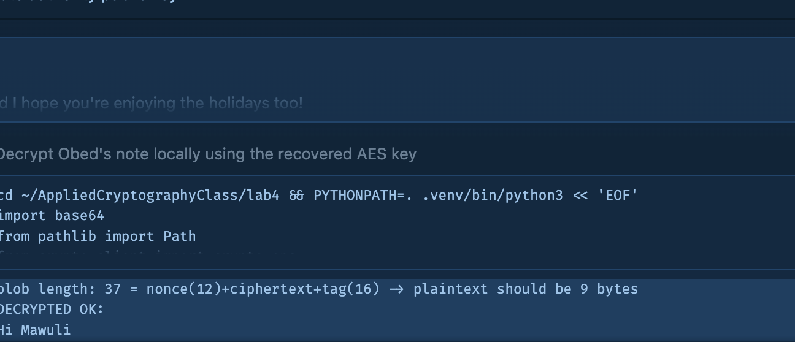
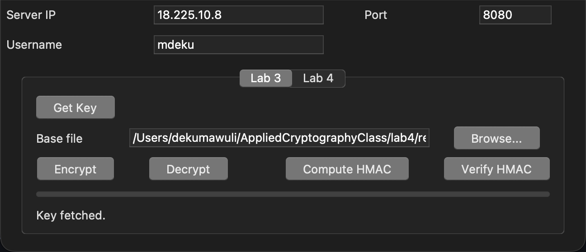
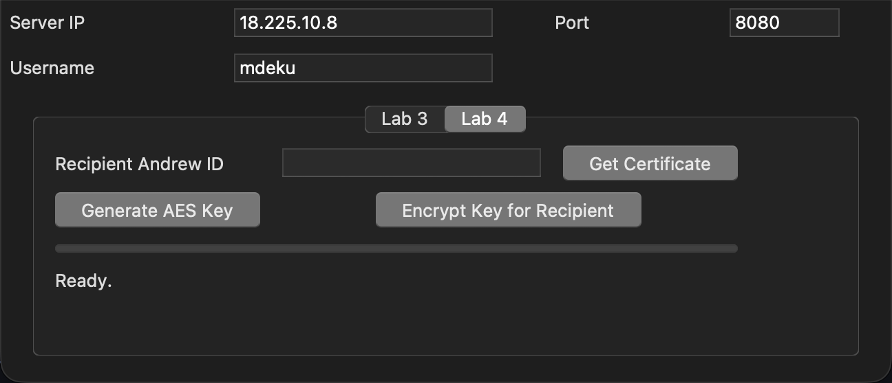
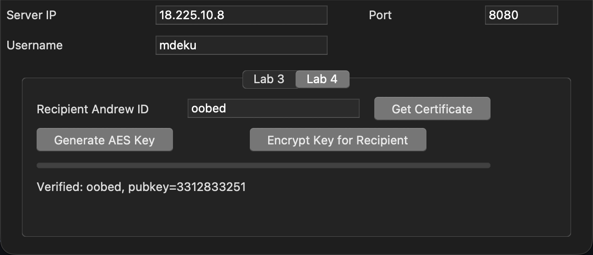
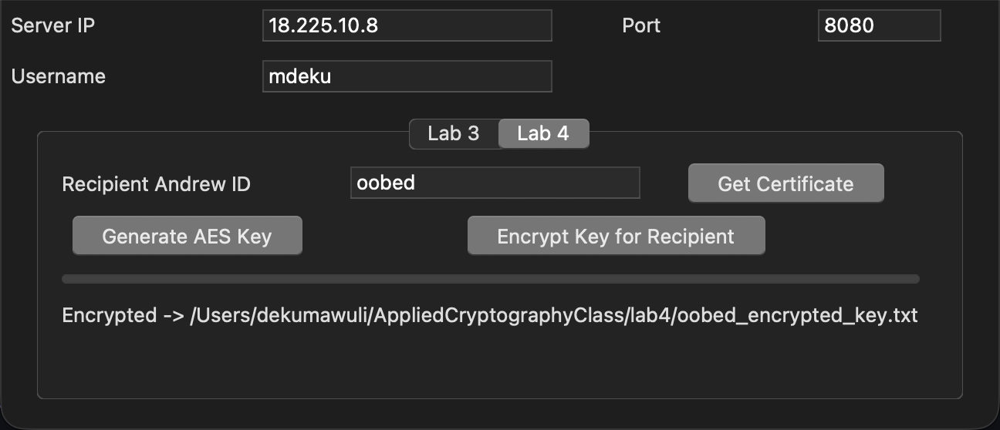

# Applied Cryptography Lab 4 — El Gamal and Certificates

A tkinter client implementing `crypto_message_spec_v3.md`'s certificate fetch/verify
and El Gamal key transport, on top of lab3's unchanged AES-256-GCM encrypt/decrypt
and custom HMAC compute/verify, against the instructor's server. The UI is a
two-tab notebook: Lab 3's workflow unchanged in one tab, the new certificate +
El Gamal workflow in the other.

Source repository: <https://github.com/DekuMawuli/lab4-applied-crypto>

## Workflow (lineage visible in git history)

1. `Requirements_v1.md` — student-authored, committed before any AI involvement.
2. `requirements_v2.md`, `design_v1.md` — AI-assisted refinement.
3. `crypto_client/` — source and tests.
4. `interrogation.md` — design/implementation Q&A.

## Where to find the results

- `crypto_client/tests/` — automated tests, including the spec's section 13.5
  certificate test vector (and its tamper/substitution/parameter-mismatch
  rejections), the chunked El Gamal encode/decode round trip, and an offline
  round trip against `fake_server.py`.
- Run them: `.venv/bin/python -m pytest crypto_client/ --ignore=crypto_client/tests/test_ui_common.py`
  (45 passing as of the last commit; `test_ui_common.py` passes separately, 1
  passing — see `results/ROUND_TRIP.md` for why it can't run in the same
  process here).
- `results/ROUND_TRIP.md` — evidence of all four round trips against the real
  server (`18.225.10.8:8080`, user `mdeku`): AES-GCM encrypt/decrypt matches
  the original file byte-for-byte, HMAC verify returns `VERIFIED` then
  `FAILED` after a one-byte tamper (both unchanged from lab3), and two real
  certificate fetch + verify + El Gamal key encryptions, for `mperkin2` and a
  classmate (`oobed`), including a confirmed two-way exchange with that
  classmate (see below). Key material is never committed (`.key`/`.hmackey`/
  `keypair.txt`/`config.local.json`/the El Gamal-encrypted key exchange files
  are all gitignored).

## Screenshots: the app working against the real server

Captured by driving the real UI (`results/screenshots/_capture_demo.py`) through
both tabs end-to-end, since the AES/HMAC/El Gamal keys themselves can't be
shared for someone else to re-run this independently.

| | |
|---|---|
|  |  |
| Initial state, idle, both tabs ready | Lab 3 tab, after `Get Key` — unchanged from lab3 |
|  |  |
| Lab 4 tab, idle | After `Get Certificate` for classmate `oobed` — real server fetch, RSA-PSS signature verified, public key `3312833251` |
|  | |
| After `Encrypt Key for Recipient` — El Gamal-encrypted AES key written for `oobed` | |

## Two-way key exchange with a classmate (`oobed`)

This wasn't just a one-sided test — a real classmate (Obed) and I exchanged
El Gamal-encrypted AES keys both directions and independently confirmed them:

1. I fetched and verified `oobed`'s certificate, generated an AES key, encrypted
   it for him, and uploaded it to the shared Drive. He decrypted it with his
   private key and confirmed he got the exact key I generated.
2. He did the same for me: generated his own AES key, encrypted it with *my*
   verified public key, and also encrypted a short note with that AES key,
   uploading both to the shared Drive.
3. I downloaded both files, decrypted the AES key with my private key (via
   `elgamal.decode_b64_lines`, the same function `encode_b64_string`'s round-trip
   tests use), then decrypted his note locally with that recovered key
   (`crypto_ops.decrypt_local`) and got back the plaintext `"Hi Mawuli"` —
   proving the whole chain (certificate trust → El Gamal key transport → AES
   decrypt) works correctly in both directions, between two independently
   built clients.
